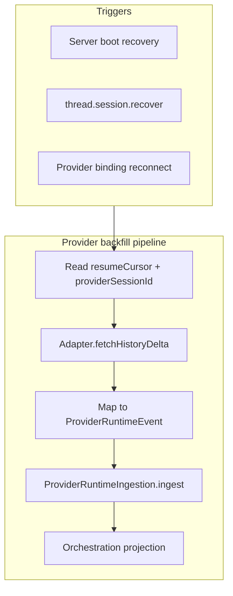

# Provider history backfill plan

## Problem

Agent session continuity work (Dev attach, recovery UX, orchestration replay) fixes:

- **Main survival** during staging/Dev relaunch
- **Paused detection** and bulk resume UX
- **Orchestration event replay** on WebSocket reconnect (client store catches up from server projection)

It does **not** fill gaps in **provider-native transcript** when the provider kept running but T3 lost the stream (hard kill, Convex outage during ingest, long disconnect without WS replay coverage).

`thread.session.recover` / `resumeCursor` reconnects the live provider session but does not automatically re-fetch assistant/tool events the adapter missed while T3 was down.

## Goal

After recovery or reconnect, for each thread with a persisted `resumeCursor`:

1. Reattach to the provider session (existing `ProviderSessionStartupRecovery` path).
2. **Backfill** missed events from the provider adapter (Codex app-server, Cursor, etc.) from `resumeCursor` (or provider-specific cursor) through current head.
3. Ingest backfilled events through `ProviderRuntimeIngestion` so orchestration turns, sidebar status, and ChatView match provider reality.

## Non-goals

- Replacing orchestration replay (keep both: replay for projection gaps, backfill for provider stream gaps).
- Backfilling when no resume state exists (user must start a new turn — existing `MISSING_RESUME_STATE_ERROR` behavior).
- Staging desktop running provider agents (`isLocalStagingProviderRuntimeBlocked`).

## Architecture



## Implementation tracks

### Track 1 — Adapter contract

**Files:** `packages/contracts` (provider adapter types), per-driver adapter modules under `apps/server/src/provider/`.

Add optional adapter capability:

```ts
type ProviderHistoryBackfillRequest = {
  sessionId: string;
  fromCursor: string; // opaque provider cursor
  limit?: number;
};

type ProviderHistoryBackfillResult = {
  events: ProviderStreamEvent[];
  nextCursor: string | null;
  complete: boolean;
};
```

- `fetchHistoryDelta(request): Effect<ProviderHistoryBackfillResult, ProviderBackfillError>`
- Document per-driver support matrix (Codex vs Cursor vs blocked drivers).

### Track 2 — Backfill orchestration service

**Files:** new `ProviderSessionHistoryBackfill.ts` layer + service interface.

Behavior:

1. Gate on Convex/persistence ready (same retry as boot recovery).
2. For each binding with `resumeCursor`, call adapter backfill in pages until `complete`.
3. Idempotent ingest: dedupe by provider event id / sequence already in projection.
4. Emit progress lifecycle events for UI (`provider.session.backfill.started` / `completed` / `failed`).
5. On partial failure: mark session `paused` with actionable error; do not silently drop events.

### Track 3 — Wire triggers

| Trigger | When | Notes |
|---------|------|-------|
| Boot | After `recoverActiveSessions` in `serverRuntimeStartup.ts` | Optional flag `T3CODE_PROVIDER_BACKFILL_ON_BOOT=1` default on main |
| Manual recover | `thread.session.recover` dispatch path | Backfill before marking running |
| WS reconnect | Provider binding heartbeat restored | Debounce 2s; skip if boot backfill in flight |

### Track 4 — Client UX

**Files:** `ChatView.tsx`, `session-logic.ts`, optional toast extension.

- Show inline “Syncing agent history…” when backfill in progress for active thread.
- Extend recovery summary: `{ backfillingCount, backfillFailedCount }`.
- Do not show on staging app.

### Track 5 — Tests

- Unit: adapter mock returns delta pages; ingestion dedupes duplicates.
- Integration: simulate kill mid-turn → restart → backfill restores missing assistant chunks in projection.
- Contract test per supported driver (Codex first).

## Verification

```bash
cd t3code-staging
bun fmt && bun lint && bun typecheck
bun test apps/server/src/provider --run
```

Manual:

1. Start agent turn on main.
2. Kill T3 server only (not provider) or block ingest briefly.
3. Restart main; confirm backfill fills missing messages without duplicate bubbles.

## Open questions (resolve in implementation chat)

1. Does Codex app-server expose historical item deltas by session id + cursor, or only live stream?
2. Maximum backfill window / event count before prompting user?
3. Should backfill run concurrently for N sessions or strictly sequential to avoid provider rate limits?

## Suggested implementation order

1. Track 1 (contract + Codex adapter spike)
2. Track 2 (service + idempotent ingest)
3. Track 3 boot + manual recover wiring
4. Track 4 UX
5. Track 5 tests + second driver
